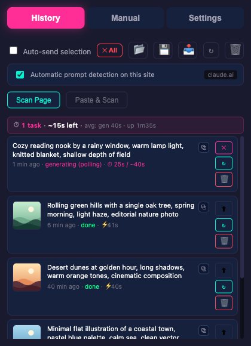
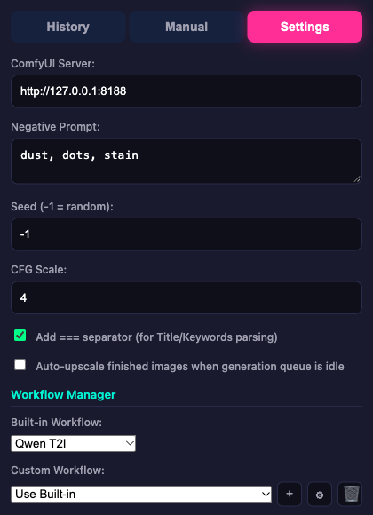

# ComfyUI Prompt Manager

A Chrome Manifest V3 extension for collecting image prompts from the web, managing them in a browser-side history, and sending them directly to a local or networked ComfyUI server.

The extension is built for people who ideate in a browser, collect prompts from pages or AI chats, and want a small control center for sending those prompts into ComfyUI without copy/pasting workflow JSON by hand.

<p>
  
  
</p>

The screenshots use made-up prompts and placeholder images.

## What It Does

ComfyUI Prompt Manager turns Chrome into a prompt capture and generation companion:

- Capture selected text from any regular web page with the context menu or `Ctrl+Shift+P`.
- Detect prompts automatically when pages contain configurable start/end markers.
- Scan the current page or pasted text for multiple marked prompts.
- Keep a local prompt history with generation status, thumbnails, copy actions, import/export, and delete controls.
- Send prompts to ComfyUI using built-in Qwen Image workflows or imported custom workflows.
- Track base image generation and optional upscale jobs from the popup and injected page UI.
- Recover prompts from ComfyUI-generated PNG metadata.

## Core Features

### Prompt Capture

- Right-click selected text and choose "Save as Prompt".
- Use the keyboard shortcut `Ctrl+Shift+P` on Windows/Linux or `Command+Shift+P` on macOS.
- Paste prompts manually into the popup and generate from there.
- Enable per-site automatic detection for prompt blocks between markers.
- Run one-off scans on the current page or pasted page content.

### Prompt Format Support

The default detector looks for prompts between:

```text
[PROMPT START]
...
[PROMPT END]
```

Prompts can include metadata before an `===` separator:

```text
[PROMPT START]
Title: Serene Mountain Lake at Golden Hour
Keywords: mountain, lake, sunset, nature, landscape, peaceful, reflection
Aspect Ratio: 16:9
Negative: dust, dots, stain
===
A photorealistic view of a crystal clear mountain lake during golden hour,
with snow-capped peaks reflected in still water, warm clouds, detailed
natural lighting, high quality
[PROMPT END]
```

The extension currently recognizes `Aspect Ratio:` and `Negative:` when preparing the ComfyUI payload. The title and keyword fields are preserved in history and PNG metadata workflows for downstream tools.

### ComfyUI Generation

- Configure the ComfyUI server address, API path, seed, steps, CFG scale, negative prompt, aspect ratio, and megapixel target.
- Submit base generation jobs through the Manifest V3 background service worker.
- Poll ComfyUI with Chrome alarms so work can continue even when the popup closes.
- Show generation state, elapsed time, thumbnails, and completed image previews.
- Cancel individual jobs or cancel all active generation/upscale work.

### Built-In Workflows

The project includes built-in workflow templates for:

- `Qwen T2I` - base Qwen text-to-image generation with a separate standard KSampler upscale workflow.
- `Qwen T2I + SeedVR` - base Qwen text-to-image generation with a separate SeedVR upscale workflow.

The background orchestrator keeps SeedVR work serialized to reduce GPU memory pressure. Upscales are queued separately and are submitted only after base generation work is idle.

### Custom Workflow Import

You can import ComfyUI API-format workflow JSON from the Settings tab. The extension attempts to detect mappings for common parameters such as prompt text, negative prompt, seed, steps, CFG, aspect ratio, megapixels, and output image node.

Imported workflows can be selected from the popup and edited through the parameter mapping panel.

### History and Recovery

- Stores up to 50 prompt entries in `chrome.storage.local`.
- Exports and imports prompt history as JSON.
- Imports prompts from ComfyUI PNG metadata.
- Keeps base and upscaled image URLs when available.
- Shows timing summaries for recent generation and upscale runs.

## Installation

### Prerequisites

- Google Chrome or another Chromium-based browser
- Node.js and npm
- A running ComfyUI server reachable from Chrome

### Build and Load

```bash
npm install
npm run build
```

Then load the extension in Chrome:

1. Open `chrome://extensions/`.
2. Enable "Developer mode".
3. Click "Load unpacked".
4. Select the project root folder, the folder that contains `manifest.json`.

Do not select `dist/` directly. The manifest, popup HTML, icons, and generated scripts are loaded together from the project root.

## Permissions

Chrome warns that the extension can "read and change all your data on all websites".
Here is what each permission is used for:

| Permission | Why |
|---|---|
| `contextMenus` | The "Save as Prompt" item in the right-click menu |
| `storage` | Settings (`chrome.storage.sync`) and the prompt history (`chrome.storage.local`) |
| `activeTab`, `scripting` | Injects the prompt detector into the open tab when you turn on auto-detection or press Scan Page |
| `tabs` | Finds the active tab and talks to the detector running in it |
| `alarms` | Polls ComfyUI for finished generations while the popup is closed |
| `host_permissions: http://*/*, https://*/*` | Prompt detection works on any site you choose, and the ComfyUI server can be at any address on your network |

The extension sends data only to the ComfyUI server set in Settings (default
`http://127.0.0.1:8188`): prompts, workflow JSON and, for upscales, the generated image.
It makes no other network requests. The prompt detector is injected only into the tab
you have open, when you press Scan Page or open the popup on a site where you turned
auto-detection on.

## Configuration

Open the extension popup and use the Settings tab to configure:

- ComfyUI server URL, for example `http://127.0.0.1:8188`.
- Default negative prompt.
- Seed, steps, CFG scale, aspect ratio, and megapixel target.
- Built-in workflow type.
- Optional auto-send for captured selections.
- Optional auto-upscale when the generation queue is idle.
- Prompt start/end markers for automatic detection.
- Custom workflow imports and parameter mappings.

Most users should set this to their own ComfyUI address before generating, such as `http://127.0.0.1:8188` for a local server.

## Typical Workflow

1. Create or find prompts in a browser page, AI chat, notes app, or research page.
2. Wrap reusable prompts with `[PROMPT START]` and `[PROMPT END]`.
3. Capture them with selection save, page scan, paste scan, or automatic detection.
4. Review the prompt history in the popup.
5. Send selected prompts to ComfyUI or enable auto-send.
6. Watch status, thumbnails, timing, and upscale progress from the popup or injected page UI.
7. Export history or recover prompt text from generated PNGs when needed.

## Project Structure

```text
browser-to-comfyui-extension/
  manifest.json              Chrome extension manifest
  popup.html                 Popup shell
  popup.css                  Popup styling
  options.html               Options page shell
  src/
    background.ts            Service worker and generation orchestration
    popup.ts                 Popup UI, settings, history, scans
    content.ts               Injected page UI and automatic detection
    types.ts                 Shared settings, history, and workflow types
    utils.ts                 Storage helpers, ComfyUI client, workflow builders
    workflow-utils.ts        Imported workflow mapping support
    png-metadata.ts          PNG tEXt metadata parser
    workflows/               Built-in ComfyUI workflow templates
  docs/                      Detailed workflow and prompt-format notes
  dist/                      Generated build output
```

## Development

```bash
npm run dev      # Vite watch build
npm run build    # Production build into dist/
npm run clean    # Remove dist/
```

The codebase uses TypeScript with `strict` enabled. There is no configured test runner yet, so `npm run build` is the primary verification command.

Generated files in `dist/` are ignored and should not be edited manually.

## Documentation

More detailed notes live in:

- [DOCS.md](DOCS.md) - broader user and developer documentation
- [docs/PROMPT_FORMAT.md](docs/PROMPT_FORMAT.md) - prompt format convention
- [docs/WORKFLOW.md](docs/WORKFLOW.md) - end-to-end stock image workflow context
- [docs/workflow-update-guide.md](docs/workflow-update-guide.md) - workflow template maintenance
- [docs/prompt-detection.md](docs/prompt-detection.md) - automatic detection details

## License

[BSD 3-Clause](LICENSE)
